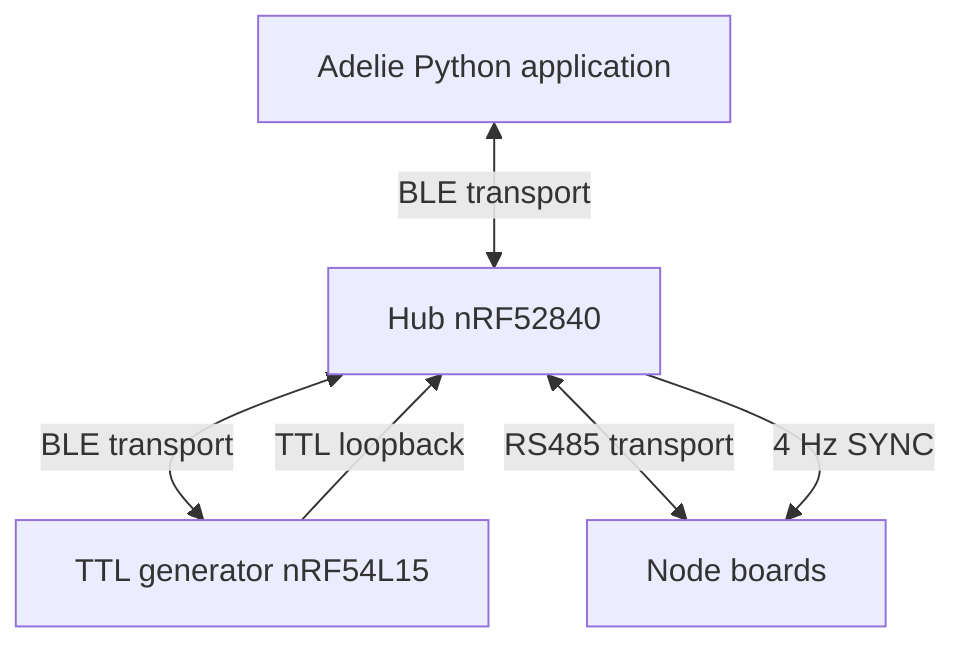

# Floating platform firmware

This project contains firmware for one hub, one TTL generator, and a configurable number of node boards. It also contains the Adelie Python application and the shared wire protocol library.

The default maximum is five node boards. Change `RIG_MAX_NODES` in `shared/include/rig_protocol/system_config.hpp` or pass it as a build definition.

## Naming conventions

The names match the hex_behav rig (see `hecate/README.md` there). Each
codename is listed once, here, so old notes and recordings stay readable.

| Board             | Role                        | MCU          | Firmware                          | Former codename |
| ----------------- | --------------------------- | ------------ | --------------------------------- | --------------- |
| **Hub**           | Floating platform hub       | nRF52840     | [`hub`](hub/)                     | Korora          |
| **Reward port**   | One per port (a bus *node*) | STM32G071\*  | [`reward_port`](reward_port/)     | Fairy           |
| **TTL generator** | Static DAQ TTL sync         | nRF54L15     | [`ttl_generator`](ttl_generator/) | Galapagos       |

"Node" means any board on the hub's RS485 bus (here, the reward ports).
Adelie, the host application, keeps its name.

| Protocol      | Direction / layer                                              | Former codename |
| ------------- | -------------------------------------------------------------- | --------------- |
| **Record**    | boards → host: timestamped telemetry and event records         | Fairy           |
| **Command**   | host → boards: commands and their responses                    | Adelie          |
| **Node identity** | node boards: the node number flashed into each board, which fixes its RS485 address | — |
| **Discovery** | retired; only the hub's boot-time "make outputs safe" message remains | Magellan        |
| **Transport** | frames over UART / RS485 and BLE                               | —               |

The shared C++ library is `rig_protocol` (namespace `rig`), formerly
`fairy_shared` (namespace `fairy`). The hub advertises over BLE as
"Floating Hub" and the TTL generator as "TTL Generator" (formerly "korora"
and "galapagos"), so a hub flashed before the rename will not be found by the
current Adelie, and vice versa.

## System structure



The hub is the time authority and the only RS485 bus master. TTL generator creates scheduled TTL pulses. Node boards capture light gate and SYNC edges and drive the local outputs. Adelie names the ports, sends commands, displays live quality, and writes experiment records.

All machine data uses one of these application protocols:

- Record v3 for records
- Command v2 for commands and responses
- Node identity v1 for each node board's flashed number (`docs/protocols/node_identity_v1.md`)

The application messages always use Transport v1 on BLE or RS485. Human debug text is isolated in each `debug_log` module and is never parsed by the system.

## Folders

| Folder      | Purpose                                                         |
| ----------- | --------------------------------------------------------------- |
| `shared`    | C++ transport, protocol, clock, queue, and byte utilities       |
| `hub`    | Zephyr firmware for the nRF52840 hub                            |
| `ttl_generator` | Zephyr firmware for the nRF54L15 TTL board                      |
| `reward_port` | STM32Cube and PlatformIO firmware for STM32G071 boards       |
| `adelie`    | Python 3.14 control, recording, parsing, analysis, and plotting |
| `docs`      | Wire protocol specifications and operating rules                |

## Fixed timing values

| Setting               |                              Value |
| --------------------- | ---------------------------------: |
| Common timestamp rate |          16000000 ticks per second |
| SYNC rate             |                               4 Hz |
| RS485 baud            |                             460800 |
| RS485 format          | 8 data bits, no parity, 1 stop bit |
| Node TIM2 rate       |                             16 MHz |
| Prototype VLOAD       |                            5000 mV |

One timer tick is 62.5 ns.

## Build summary

Use a current Zephyr or nRF Connect SDK workspace for the Nordic firmware.

```bash
west build -p always -b nrf52840dk/nrf52840 hub
west flash
```

```bash
west build -p always -b nrf54l15dk/nrf54l15/cpuapp ttl_generator
west flash
```

Build the prototype node firmware with PlatformIO.

```bash
pio run -d reward_port -e nucleo_g071rb_auto_rs485
pio run -d reward_port -e nucleo_g071rb_auto_rs485 -t upload
```

Install Adelie in a Python 3.14 virtual environment.

```bash
cd adelie
python -m venv .venv
python -m pip install -e .
adelie
```

## Initial setup

1. Flash each node board with its number, once: `python reward_port/scripts/flash.py --id N` (0 to 4), and write the number on the board
2. Power Hub, TTL generator, and all node boards, in any order
3. Start Adelie and connect to the hub
4. In Developer › Board setup, tick the node numbers this rig uses, label the ports if wanted, and save
5. Wait for every clock model to become valid
6. Choose a new `.log` path
7. Press Record Start

Node N always uses RS485 address `0x10 + N`, so there is no discovery or assignment step. A replacement board just needs the same number flashed into it.

## Run behavior

Hub starts polling every node slot, health checks, and SYNC without Adelie. It does not save experiment data.

Record Start creates a session on every board. An unexpected Adelie disconnect ends that session and turns controlled outputs safe. Polling, SYNC, and health work continue until power is removed.

A node communication timeout, a node restart, or a TTL generator disconnect also ends the complete session. The fault is sent to Adelie before the remaining boards are stopped.

Critical records are always forwarded. Standard mode adds health and clock quality. Full mode adds raw SYNC observations and clock pairs.

## Safety

The valve starts off and has a hard 250 ms maximum time. It rejects overlap and enforces a minimum interval. RGB, IR, audio, and valve outputs enter safe states on reset and session stop. Audio has a 10 ms onset and offset ramp. On the PCBs, Hub and the final node profile drive an RS485 direction pin (DE and /RE tied together) only while transmitting. The DK and Nucleo prototype rig uses automatic direction RS485 modules, and the Nucleo profile drives no direction pin.
